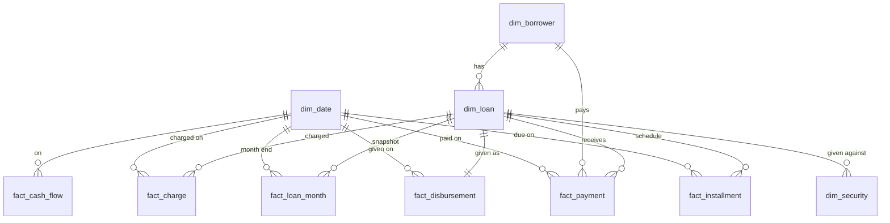

# Analytics: the star schema

The app keeps **two layers** in the same PostgreSQL database:

| Layer | Schema | What it is for | Who writes |
| --- | --- | --- | --- |
| Operational (the ledger) | `public` | Entering and keeping the data: one table per thing (borrower, guarantor, consent, loan, security, installment, payment, charge, cash entry …). Database rules keep every rupee exact (append-only payments, allocations that must add up, locked terms). | The app only |
| Analytics (star schema) | `analytics` | Reports, charts and ad-hoc questions. Dimensions describe *who, what, where, when*; facts hold *the numbers*. | Rebuilt from the ledger by `analytics.refresh()` |

Each person's details live in their own operational tables (`borrower`, `guarantor`, `consent`,
`collateral` …). The star schema copies only what analysis needs, so the ledger's rules never
get in the way of a query, and a query can never change the money.

## The model



Joins use **keys**: `borrower_key`, `loan_key` (the operational ids) and **date keys** in the form
`YYYYMMDD` (for example `20261104`), which join to `dim_date.date_key`. Money is in **rupees**
(`numeric(14,2)`), not paise.

### Dimensions

| Table | One row per | Main columns |
| --- | --- | --- |
| `dim_date` | calendar day, 2010–2040 | date, day, month, month_name, quarter, year, `fy_start_year` (Indian FY, April–March), weekday, iso_week, month_start, month_end |
| `dim_borrower` | borrower | code, name (EN/TA), **occupation, town, district, pincode**, language, status, joined_date_key, kyc_complete, guarantors, erased |
| `dim_loan` | loan | loan_no, borrower_key, method, frequency, rate, rate_monthly, term, installments, principal, handed_over, scheduled_interest, true_cost_monthly, security_kind, ltv_percent, status, recovery_status, is_topup, size_band, disbursal / maturity / closed date keys |
| `dim_security` | vehicle or land | loan_key, kind, vehicle_type, condition, make_model, vehicle_year, village, taluk, district, value, lien_noted_on_rc, ec_checked, insurance_expiry, released |

### Facts

| Table | Grain (one row per) | Measures |
| --- | --- | --- |
| `fact_disbursement` | loan given | principal, handed_over, charges_taken_out, charges_added, mode |
| `fact_installment` | installment (replaced ones kept, flagged) | installment, principal, interest, paid_principal, paid_interest, paid_late_fee, waived, waived_late_fee, **unpaid**, settled, replaced, **days_overdue** |
| `fact_payment` | payment (a reversal is negative) | amount = principal + interest + late_fee + charges, kind, mode, receipt_no |
| `fact_charge` | charge after the loan was given | kind, amount, paid, waived, due |
| `fact_cash_flow` | line of the daily log | direction (in/out), source_type (payment, loan, loan_charge, cash_entry, refund …), mode, amount, category (EN/TA) |
| `fact_loan_month` | loan × month-end (periodic snapshot) | **principal_outstanding, overdue_amount, days_past_due, dpd_bucket**, principal_collected, interest_collected |

`fact_loan_month` gives trends over time (portfolio size, overdue ageing, collections) without
recalculating history in every query. Installments replaced by a part payment or restructure count
until the date of that change.

## Freshness

* Rebuilt **every night** by the worker (after the day's checks) and **on demand** by the owner:
  `POST /api/v1/analytics/refresh`. `GET /api/v1/analytics/status` shows when it last ran, how long
  it took and the row counts. Rebuilding never touches the ledger.
* A reconciliation test proves after real activity (payments, a reversal, charges, a part payment,
  an early closing, cash entries) that the facts agree with the ledger to the paisa.

## Privacy and access

* No Aadhaar (not even the last 4 digits), phone numbers, addresses, passwords or 2FA secrets are in
  the `analytics` schema; a test fails if such a column ever appears.
* The role **`analytics_reader`** can read the `analytics` schema and nothing else (no `public`
  tables, cannot run the refresh). To query from a tool (pgAdmin, DBeaver, Excel, Metabase), the
  owner creates a login that has this role — on the home server only, never exposed to the internet:

  ```sql
  CREATE ROLE owner_reports LOGIN PASSWORD '<a long password>' IN ROLE analytics_reader;
  ```

## Example questions

```sql
-- Money collected per month (this financial year), split into principal and interest
SELECT d.year, d.month_name, sum(p.principal) AS principal, sum(p.interest) AS interest, sum(p.amount) AS total
FROM analytics.fact_payment p JOIN analytics.dim_date d ON d.date_key = p.paid_date_key
WHERE d.fy_start_year = 2026 GROUP BY d.year, d.month, d.month_name ORDER BY d.year, d.month;

-- Portfolio and overdue ageing at each month end (for a stacked bar chart)
SELECT m.month_end_key, m.dpd_bucket, sum(m.principal_outstanding) AS outstanding, count(*) AS loans
FROM analytics.fact_loan_month m GROUP BY 1, 2 ORDER BY 1, 2;

-- Where the money is: outstanding by district and occupation
SELECT b.district, b.occupation, count(DISTINCT l.loan_key) AS loans, sum(i.unpaid) AS unpaid
FROM analytics.fact_installment i JOIN analytics.dim_loan l ON l.loan_key = i.loan_key
JOIN analytics.dim_borrower b ON b.borrower_key = l.borrower_key
WHERE l.status = 'active' GROUP BY 1, 2 ORDER BY unpaid DESC;

-- Vehicle loans: average loan-to-value and overdue rate by vehicle type
SELECT s.vehicle_type, count(*) AS loans, round(avg(l.ltv_percent), 1) AS avg_ltv,
       round(100.0 * count(*) FILTER (WHERE m.days_past_due > 30) / count(*), 1) AS pct_over_30_days
FROM analytics.dim_security s JOIN analytics.dim_loan l ON l.loan_key = s.loan_key
JOIN analytics.fact_loan_month m ON m.loan_key = l.loan_key
  AND m.month_end_key = (SELECT max(month_end_key) FROM analytics.fact_loan_month)
WHERE s.kind = 'vehicle' GROUP BY 1;

-- Interest earned per month (collected interest + late fees)
SELECT d.year, d.month, sum(p.interest + p.late_fee) AS earned
FROM analytics.fact_payment p JOIN analytics.dim_date d ON d.date_key = p.paid_date_key GROUP BY 1, 2 ORDER BY 1, 2;

-- Own spending by category this month
SELECT f.category_en, f.category_ta, sum(f.amount) AS spent
FROM analytics.fact_cash_flow f JOIN analytics.dim_date d ON d.date_key = f.date_key
WHERE f.source_type = 'cash_entry' AND f.direction = 'out' AND d.month_start = date_trunc('month', current_date)
GROUP BY 1, 2 ORDER BY spent DESC;

-- Best and slowest payers: share of installments paid late (last 12 months)
SELECT b.code, b.name, count(*) AS due, count(*) FILTER (WHERE i.days_overdue > 0) AS late
FROM analytics.fact_installment i JOIN analytics.dim_borrower b ON b.borrower_key = i.borrower_key
JOIN analytics.dim_date d ON d.date_key = i.due_date_key
WHERE NOT i.replaced AND d.date BETWEEN current_date - 365 AND current_date
GROUP BY 1, 2 ORDER BY late DESC;
```

## Next: the dashboard (plan)

A **Dashboard** page in the app (owner only, English and Tamil, laptop-first), reading from
`analytics` through a few read-only API endpoints with date-range and filter parameters (district,
occupation, method, vehicle type, security). Charts:

| Chart | Source | Type |
| --- | --- | --- |
| Portfolio outstanding over time, split by overdue bucket | `fact_loan_month` | stacked area / bar |
| Collections per month: principal vs interest vs late fee vs charges | `fact_payment` × `dim_date` | stacked bar |
| Loans given per month (count and amount) | `fact_disbursement` | bar + line |
| Money in vs money out per day / month, with net | `fact_cash_flow` | bar |
| Overdue ageing now (1–30, 31–60, 61–90, 90+) | latest `fact_loan_month` | bar |
| Outstanding by district / town / occupation | `fact_installment` × `dim_borrower` | ranked bar |
| Vehicle vs land vs no security: outstanding and overdue % | `dim_security`, `fact_loan_month` | grouped bar |
| Average true cost, loan size bands, top borrowers | `dim_loan` | tables / bars |
| Own spending by category | `fact_cash_flow` | bar |

Each chart gets a table view (and CSV) of the same numbers, uses one colour per meaning (in = green,
out = red, overdue = amber) and a pattern or label as well as colour.
